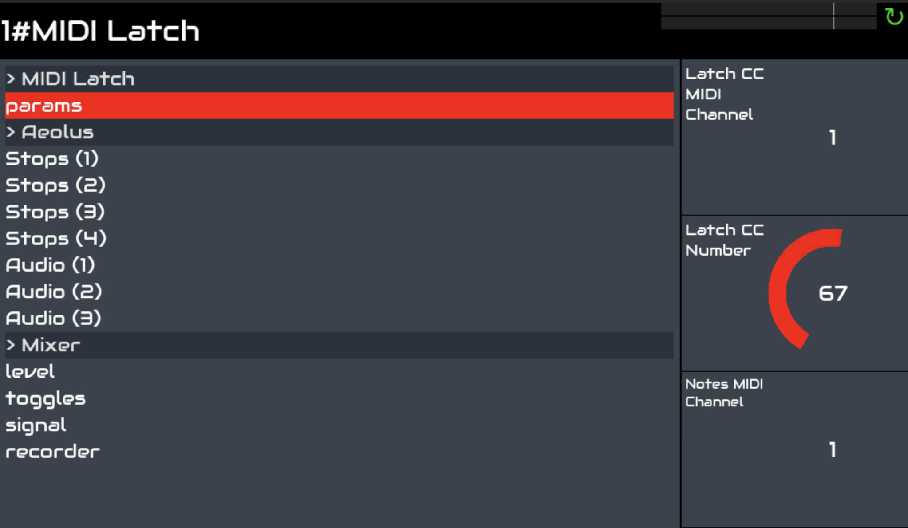

# MIDI Latch LV2 plugin

A simple LV2 plugin implementing a "Latch" pedal.

The latch works similarly to a sostenuto pedal, but instead of being "sustained", notes depressed in the instant the pedal is pressed are held until the pedal is released. This is useful e.g. when holding organ bass notes.

This is the function of the sostenuto pedal when using organ sounds on my Yamaha Clavinova. Since I got fed up with its digital instruments, I have switched to using a headless [Zynthian](https://github.com/zynthian) setup. I could not find this feature in Zynthian, and hence the existence of this plugin.

The plugin has UI controls for setting pedal channel/CC, and setting channel on which the latch acts.

## Building
__(For Raspberry Pi/Zynthian, I have not tried building for other targets)__

- Compile to `aarch64-unknown-lilnux-gnu`
- Copy `/target/aarch64-unknown-linux-gnu/release/libmidi_latch.so` to `/midi-latch.lv2/libmidi_latch.so`
- Copy `midi-latch.lv2` to LV2 plugin folder in Zynthian, reload plugins and enable in webconfig.

